<a id="top"></a>

<div align="center">

# Awesome AI Image Prompts

<p><a href="README.md">English</a> · <a href="README_zh.md">简体中文</a> · <a href="README_ja.md">日本語</a> · <a href="README_ko.md">한국어</a> · <a href="README_es.md">Español</a> · <a href="README_fr.md">Français</a> · <a href="README_de.md">Deutsch</a> · <b>Português</b></p>

[](https://awesome.re)
[](#gallery)
[](#top)
[](LICENSE)
[](https://github.com/zenlee123/awesome-ai-image-prompts)

**Uma coleção selecionada de prompts para geradores de imagens com IA em 8 idiomas, cada um com uma prévia real gerada.**

<a href="#gallery">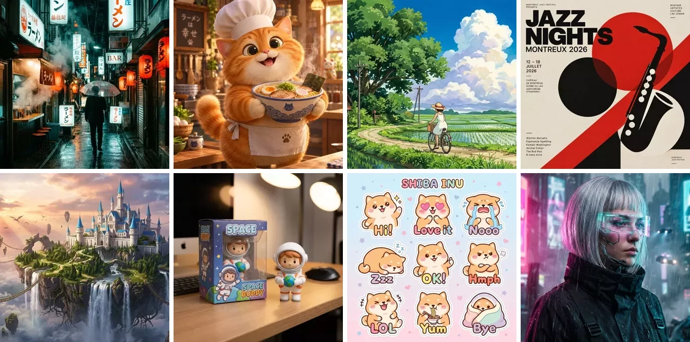</a>

<a href="https://aiimage.com/pt?utm_source=github&utm_medium=readme&utm_campaign=awesome-ai-image-prompts"></a>

[Galeria](#gallery) · [Ferramentas de imagem grátis](#tools) · [Gerar via API](#api) · [Dicas para escrever prompts](#tips) · [Contribuindo](#contributing)

</div>

Cada prompt abaixo foi executado num modelo real, e o resultado aparece logo ao lado. Copie o prompt no seu idioma e cole no Nano Banana, GPT Image, Gemini, Midjourney, Seedream, Flux ou qualquer outro gerador de imagens.

> [!TIP]
> **Teste estes prompts no AIImage.com**
>
> Sem chave de API nem configuração: abra o [AIImage.com](https://aiimage.com/pt?utm_source=github&utm_medium=readme&utm_campaign=awesome-ai-image-prompts), escolha Nano Banana Pro, Nano Banana 2 ou GPT Image 2.5, cole um prompt e receba sua imagem em segundos. **Comece grátis.**

> [!NOTE]
> As imagens de prévia foram geradas com o prompt em inglês. Os modelos multilíngues atuais dão resultados muito parecidos com os prompts traduzidos.

<a id="gallery"></a>

## Galeria

<table>
<tr>
<td width="22%"><a href="#photography"><b>Fotografia</b></a></td>
<td align="center" width="26%"><a href="#fox-snow-forest">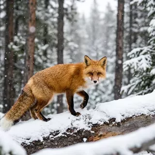</a><br><sub>Raposa-vermelha na neve</sub></td>
<td align="center" width="26%"><a href="#tokyo-rain-night">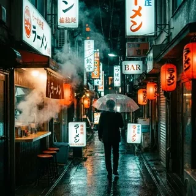</a><br><sub>Noite chuvosa em Tóquio</sub></td>
<td align="center" width="26%"><a href="#iceland-aurora">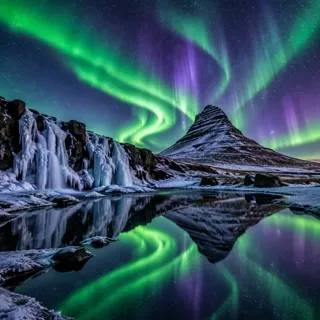</a><br><sub>Aurora sobre a Islândia</sub></td>
</tr>
<tr>
<td width="22%"><a href="#portrait"><b>Retrato e personagens</b></a></td>
<td align="center" width="26%"><a href="#elderly-fisherman">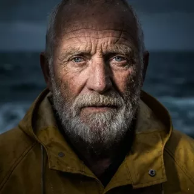</a><br><sub>Retrato de um velho pescador</sub></td>
<td align="center" width="26%"><a href="#cyberpunk-girl">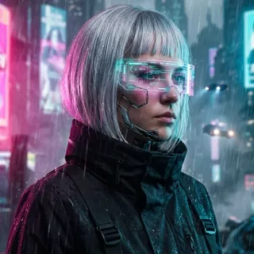</a><br><sub>Hacker cyberpunk</sub></td>
<td align="center" width="26%"><a href="#pixar-chef-cat"></a><br><sub>Gato chef estilo Pixar</sub></td>
</tr>
<tr>
<td width="22%"><a href="#product"><b>Produto e publicidade</b></a></td>
<td align="center" width="26%"><a href="#perfume-water-splash">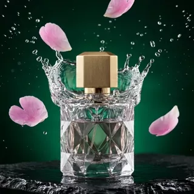</a><br><sub>Perfume com respingo de água</sub></td>
<td align="center" width="26%"><a href="#sneaker-exploded">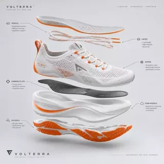</a><br><sub>Tênis em vista explodida</sub></td>
<td align="center" width="26%"><a href="#matcha-latte-flatlay">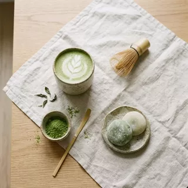</a><br><sub>Matcha latte em flat lay</sub></td>
</tr>
<tr>
<td width="22%"><a href="#poster"><b>Pôster e tipografia</b></a></td>
<td align="center" width="26%"><a href="#swiss-jazz-poster">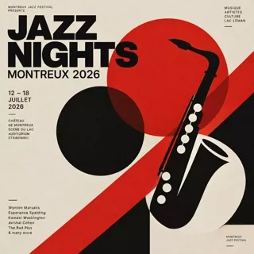</a><br><sub>Pôster de festival de jazz estilo suíço</sub></td>
<td align="center" width="26%"><a href="#retro-travel-kyoto">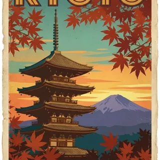</a><br><sub>Pôster de viagem vintage: Quioto</sub></td>
<td align="center" width="26%"><a href="#coffee-menu-board">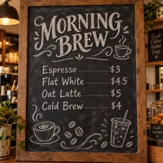</a><br><sub>Cardápio de café em lousa</sub></td>
</tr>
<tr>
<td width="22%"><a href="#illustration"><b>Ilustração e anime</b></a></td>
<td align="center" width="26%"><a href="#ghibli-countryside">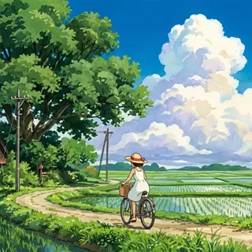</a><br><sub>Campo de verão estilo Ghibli</sub></td>
<td align="center" width="26%"><a href="#ukiyoe-astronaut">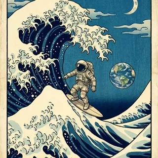</a><br><sub>Astronauta em estilo ukiyo-e</sub></td>
<td align="center" width="26%"><a href="#storybook-bear-picnic">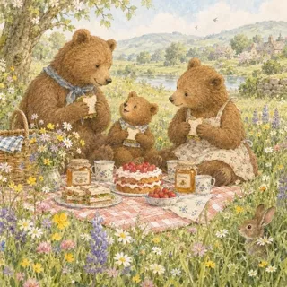</a><br><sub>Piquenique de ursos de livro infantil</sub></td>
</tr>
<tr>
<td width="22%"><a href="#3d"><b>3D e ícones</b></a></td>
<td align="center" width="26%"><a href="#isometric-coffee-shop">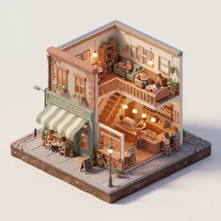</a><br><sub>Cafeteria isométrica em miniatura</sub></td>
<td align="center" width="26%"><a href="#glass-app-icons">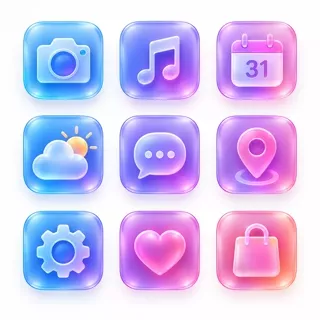</a><br><sub>Ícones de app em vidro fosco</sub></td>
<td align="center" width="26%"><a href="#clay-figurine-astronaut">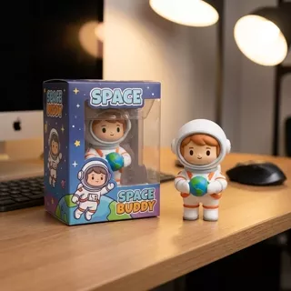</a><br><sub>Boneco colecionável na caixa</sub></td>
</tr>
<tr>
<td width="22%"><a href="#architecture"><b>Arquitetura e interiores</b></a></td>
<td align="center" width="26%"><a href="#cliff-glass-villa">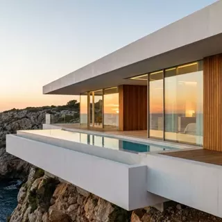</a><br><sub>Villa de vidro no penhasco</sub></td>
<td align="center" width="26%"><a href="#japandi-living-room">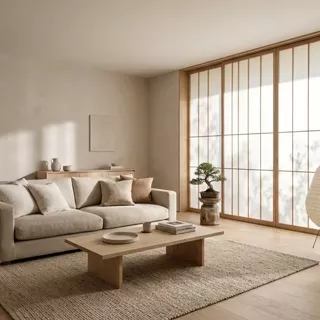</a><br><sub>Sala de estar japandi</sub></td>
<td align="center" width="26%"><a href="#solarpunk-city">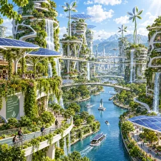</a><br><sub>Cidade solarpunk</sub></td>
</tr>
<tr>
<td width="22%"><a href="#fantasy"><b>Fantasia e arte conceitual</b></a></td>
<td align="center" width="26%"><a href="#floating-island-castle">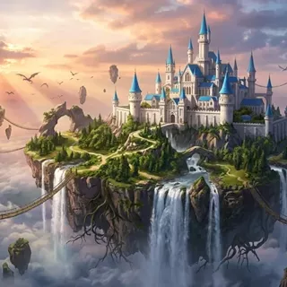</a><br><sub>Castelo numa ilha flutuante</sub></td>
<td align="center" width="26%"><a href="#forest-spirit-deer">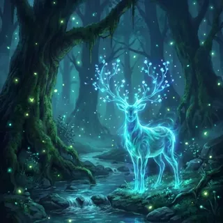</a><br><sub>Espírito luminoso da floresta</sub></td>
<td align="center" width="26%"><a href="#steampunk-airship-market">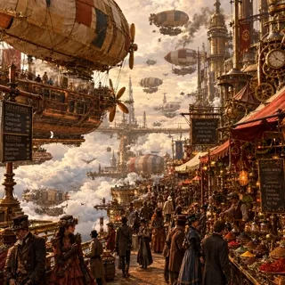</a><br><sub>Mercado de dirigíveis steampunk</sub></td>
</tr>
<tr>
<td width="22%"><a href="#infographic"><b>Infográfico e educação</b></a></td>
<td align="center" width="26%"><a href="#coffee-journey-infographic"></a><br><sub>Infográfico do grão à xícara</sub></td>
<td align="center" width="26%"><a href="#volcano-cross-section">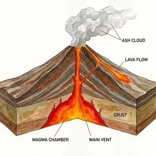</a><br><sub>Diagrama em corte de um vulcão</sub></td>
<td align="center" width="26%"><a href="#water-cycle-kids">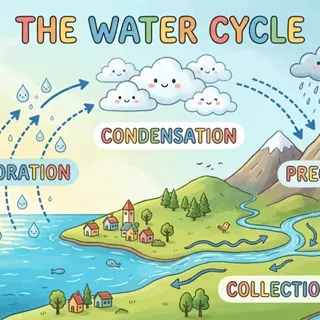</a><br><sub>Ciclo da água para crianças</sub></td>
</tr>
<tr>
<td width="22%"><a href="#character"><b>Fichas de personagem e assets de jogo</b></a></td>
<td align="center" width="26%"><a href="#ranger-turnaround-sheet">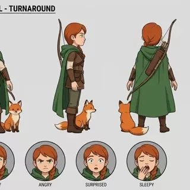</a><br><sub>Folha de giro de personagem</sub></td>
<td align="center" width="26%"><a href="#pixel-rpg-items">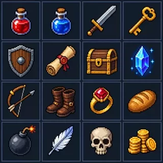</a><br><sub>Conjunto de itens RPG em pixel art</sub></td>
<td align="center" width="26%"><a href="#mobile-game-level-map">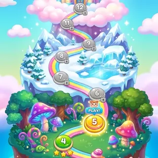</a><br><sub>Mapa de fases de jogo mobile</sub></td>
</tr>
<tr>
<td width="22%"><a href="#social"><b>Redes sociais e miniaturas</b></a></td>
<td align="center" width="26%"><a href="#youtube-thumbnail-30days">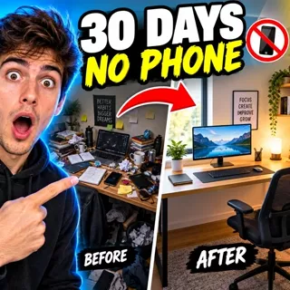</a><br><sub>Miniatura viral do YouTube</sub></td>
<td align="center" width="26%"><a href="#instagram-carousel-cover">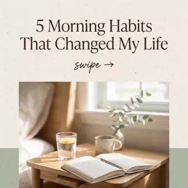</a><br><sub>Capa de carrossel do Instagram</sub></td>
<td align="center" width="26%"><a href="#shiba-sticker-pack">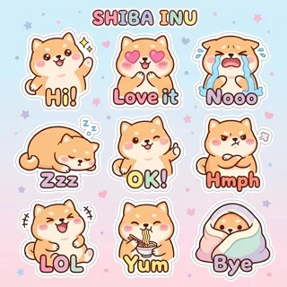</a><br><sub>Pacote de figurinhas de shiba inu</sub></td>
</tr>
<tr>
<td width="22%"><a href="#retro"><b>Estética retrô e lo-fi</b></a></td>
<td align="center" width="26%"><a href="#y2k-digicam-night-market">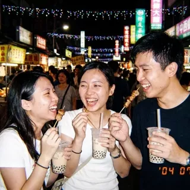</a><br><sub>Feira noturna com câmera digital Y2K</sub></td>
<td align="center" width="26%"><a href="#vhs-mall-1989"></a><br><sub>Shopping em VHS de 1989</sub></td>
<td align="center" width="26%"><a href="#polaroid-desert-roadtrip">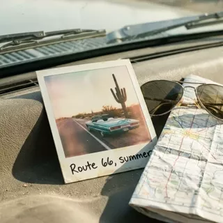</a><br><sub>Road trip no deserto em Polaroid</sub></td>
</tr>
<tr>
<td width="22%"><a href="#editing"><b>Edição de imagem (antes → depois)</b></a></td>
<td align="center" width="26%"><a href="#edit-fox-autumn">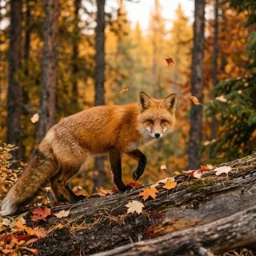</a><br><sub>Mudar a estação</sub></td>
<td align="center" width="26%"><a href="#edit-fisherman-charcoal">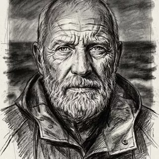</a><br><sub>De foto a desenho a carvão</sub></td>
<td align="center" width="26%"><a href="#edit-matcha-ecommerce"></a><br><sub>De foto lifestyle a imagem de e-commerce</sub></td>
</tr>
</table>

<a id="photography"></a>

## Fotografia

<a id="fox-snow-forest"></a>

### 01. Raposa-vermelha na neve


  <a href="https://aiimage.com/pt/nano-banana-2?utm_source=github&utm_medium=readme&utm_campaign=awesome-ai-image-prompts"></a>

```text
Fotografia de vida selvagem de uma raposa-vermelha em pé sobre um tronco
coberto de neve numa floresta de pinheiros,
flocos de neve caindo, a raposa olhando diretamente para a câmera,
pouca profundidade de campo, luz suave de céu nublado,
teleobjetiva de 600 mm em f/4, estilo National Geographic,
pelagem ultradetalhada
```

<details><summary>English</summary>

```text
Wildlife photograph of a red fox standing on a snow-covered log in a pine
forest,
snowflakes falling, the fox looking directly at the camera,
shallow depth of field, soft overcast light,
shot on a 600mm telephoto lens at f/4, National Geographic style,
ultra-detailed fur
```

</details>

<a id="tokyo-rain-night"></a>

### 02. Noite chuvosa em Tóquio


  <a href="https://aiimage.com/pt/nano-banana-pro?utm_source=github&utm_medium=readme&utm_campaign=awesome-ai-image-prompts"></a>

```text
Fotografia de rua num beco estreito de Tóquio à noite depois da chuva,
letreiros de neon e lanternas de papel refletidos no asfalto molhado,
uma pessoa sozinha com guarda-chuva transparente se afastando,
vapor saindo de uma casa de ramen,
gradação de cor cinematográfica azul-petróleo e laranja,
granulação de filme 35 mm, fotografada com Leica
```

<details><summary>English</summary>

```text
Street photography in a narrow Tokyo alley at night after rain,
glowing neon signs and paper lanterns reflected on wet asphalt,
a lone person with a transparent umbrella walking away,
steam rising from a ramen shop, cinematic teal and orange color grading,
35mm film grain, shot on Leica
```

</details>

<a id="iceland-aurora"></a>

### 03. Aurora sobre a Islândia


  <a href="https://aiimage.com/pt/gpt-image-2-5?utm_source=github&utm_medium=readme&utm_campaign=awesome-ai-image-prompts"></a>

```text
Fotografia de paisagem de uma aurora boreal verde e violeta girando sobre a
montanha Kirkjufell na Islândia,
uma cachoeira congelada em primeiro plano, estrelas visíveis, longa exposição,
reflexo espelhado num lago calmo, lente grande-angular de 14 mm,
nítida e muito detalhada, astrofotografia premiada
```

<details><summary>English</summary>

```text
Landscape photograph of green and violet aurora borealis swirling over
Kirkjufell mountain in Iceland,
a frozen waterfall in the foreground, stars visible, long exposure,
mirror-like reflection in a calm pond, wide-angle 14mm lens,
crisp and highly detailed, award-winning astrophotography
```

</details>

<div align="right"><a href="#top">⬆ Voltar ao topo</a></div>

<a id="portrait"></a>

## Retrato e personagens

<a id="elderly-fisherman"></a>

### 04. Retrato de um velho pescador


  <a href="https://aiimage.com/pt/nano-banana-pro?utm_source=github&utm_medium=readme&utm_campaign=awesome-ai-image-prompts"></a>

```text
Retrato em close de um pescador idoso com rosto castigado pelo tempo,
cheio de rugas profundas e barba branca, vestindo uma capa de chuva amarela,
respingos do mar na pele, olhos azuis penetrantes,
iluminação Rembrandt dramática, fundo escuro e sombrio,
fotografado com 85 mm f/1.4, textura de pele hiper-realista
```

<details><summary>English</summary>

```text
Close-up portrait of an elderly fisherman with a deeply wrinkled weathered
face and a white beard,
wearing a yellow raincoat, sea spray on his skin, piercing blue eyes,
dramatic Rembrandt lighting, dark moody background, shot on 85mm f/1.4,
hyper-realistic skin texture
```

</details>

<a id="cyberpunk-girl"></a>

### 05. Hacker cyberpunk


  <a href="https://aiimage.com/pt/nano-banana-2?utm_source=github&utm_medium=readme&utm_campaign=awesome-ai-image-prompts"></a>

```text
Retrato cinematográfico de uma jovem hacker numa cidade cyberpunk,
cabelo chanel curto prateado, visor holográfico brilhante sobre os olhos,
implantes cibernéticos cromados na bochecha, jaqueta techwear preta,
luz neon rosa e ciano dos dois lados, gotas de chuva,
luzes da cidade em bokeh ao fundo, estética de Blade Runner 2049
```

<details><summary>English</summary>

```text
Cinematic portrait of a young woman hacker in a cyberpunk city,
short silver bob haircut, glowing holographic visor over her eyes,
chrome cybernetic implants on her cheek, wearing a black techwear jacket,
pink and cyan neon light from both sides, rain droplets,
bokeh city lights behind, Blade Runner 2049 aesthetic
```

</details>

<a id="pixar-chef-cat"></a>

### 06. Gato chef estilo Pixar


  <a href="https://aiimage.com/pt/gpt-image-2-5?utm_source=github&utm_medium=readme&utm_campaign=awesome-ai-image-prompts"></a>

```text
Personagem de animação 3D no estilo Pixar,
um gato laranja rajado e gordinho vestido de chef com um chapéu branco alto e
um aventalzinho,
segurando orgulhoso uma tigela fumegante de lámen,
olhos grandes e expressivos, fundo de cozinha aconchegante e quente,
iluminação global suave, dispersão subsuperficial no pelo,
divertido e encantador
```

<details><summary>English</summary>

```text
3D animated character in the style of Pixar,
a chubby orange tabby cat chef wearing a tall white chef hat and a tiny apron,
proudly holding a steaming bowl of ramen, big expressive eyes,
cozy warm kitchen background, soft global illumination,
subsurface scattering on fur, playful and heartwarming
```

</details>

<div align="right"><a href="#top">⬆ Voltar ao topo</a></div>

<a id="product"></a>

## Produto e publicidade

<a id="perfume-water-splash"></a>

### 07. Perfume com respingo de água


  <a href="https://aiimage.com/pt/nano-banana-pro?utm_source=github&utm_medium=readme&utm_campaign=awesome-ai-image-prompts"></a>

```text
Fotografia publicitária de luxo de um frasco de perfume de vidro facetado com
tampa dourada,
sobre uma pedra preta molhada,
um respingo de água dramático em forma de coroa congelado no ar ao redor,
pétalas de peônia rosa flutuando, fundo em degradê verde-esmeralda profundo,
luz de contorno, flash de alta velocidade, ultranítida, campanha publicitária
```

<details><summary>English</summary>

```text
Luxury commercial product photography of a faceted glass perfume bottle with a
gold cap,
standing on a wet black stone,
a dramatic crown-shaped water splash frozen in mid-air around it,
floating pink peony petals, deep emerald green gradient background,
rim lighting, high-speed flash, ultra sharp, advertising campaign
```

</details>

<a id="sneaker-exploded"></a>

### 08. Tênis em vista explodida


  <a href="https://aiimage.com/pt/gpt-image-2-5?utm_source=github&utm_medium=readme&utm_campaign=awesome-ai-image-prompts"></a>

```text
Vista explodida técnica de um tênis de corrida futurista branco e laranja,
cada camada separada e flutuando numa linha horizontal organizada: solado,
entressola de espuma, placa de carbono, cabedal de malha, cadarços e palmilha,
linhas de chamada finas com pequenas etiquetas,
fundo de estúdio cinza-claro e limpo, sombras suaves,
apresentação de design de produto, render 3D fotorrealista
```

<details><summary>English</summary>

```text
Technical exploded view of a futuristic white and orange running sneaker,
every layer separated and floating in a neat horizontal line: outsole,
foam midsole, carbon plate, mesh upper, laces and insole,
thin leader lines with small labels, clean light gray studio background,
soft shadows, product design presentation, photorealistic 3D render
```

</details>

<a id="matcha-latte-flatlay"></a>

### 09. Matcha latte em flat lay


  <a href="https://aiimage.com/pt/nano-banana-2?utm_source=github&utm_medium=readme&utm_campaign=awesome-ai-image-prompts"></a>

```text
Fotografia gastronômica flat lay vista de cima de um matcha latte com latte
art em forma de folha numa xícara de cerâmica artesanal,
um batedor de bambu, uma tigelinha de matcha em pó,
folhas de chá verde espalhadas e dois mochis sobre um pano de linho numa mesa
de carvalho claro,
luz natural suave de janela, estética japonesa minimalista,
tons terrosos suaves, estilo editorial de revista
```

<details><summary>English</summary>

```text
Top-down flat lay food photography of a matcha latte with leaf latte art in a
handmade ceramic cup,
a bamboo whisk, a small bowl of matcha powder,
scattered green tea leaves and two mochi on a linen cloth over a light oak
table,
soft natural window light, minimal Japanese aesthetic, muted earthy tones,
magazine editorial style
```

</details>

<div align="right"><a href="#top">⬆ Voltar ao topo</a></div>

<a id="poster"></a>

## Pôster e tipografia

<a id="swiss-jazz-poster"></a>

### 10. Pôster de festival de jazz estilo suíço


  <a href="https://aiimage.com/pt/gpt-image-2-5?utm_source=github&utm_medium=readme&utm_campaign=awesome-ai-image-prompts"></a>

```text
Pôster no estilo tipográfico internacional suíço para um festival de jazz,
composição geométrica ousada de círculos sobrepostos e barras diagonais em
vermelho,
preto e creme, silhueta abstrata de um saxofone,
grande título em sem serifa limpa "JAZZ NIGHTS" e texto menor "MONTREUX 2026",
grid rigoroso, textura sutil de papel, inspirado em Josef Müller-Brockmann
```

<details><summary>English</summary>

```text
Swiss International Typographic Style poster for a jazz festival,
bold geometric composition of overlapping circles and diagonal bars in red,
black and cream, an abstract saxophone silhouette,
large clean sans-serif headline text "JAZZ NIGHTS" and smaller text "MONTREUX
2026",
strict grid layout, subtle paper texture, Josef Müller-Brockmann inspired
```

</details>

<a id="retro-travel-kyoto"></a>

### 11. Pôster de viagem vintage: Quioto


  <a href="https://aiimage.com/pt/nano-banana-pro?utm_source=github&utm_medium=readme&utm_campaign=awesome-ai-image-prompts"></a>

```text
Pôster de viagem vintage dos anos 1930 de Quioto, Japão,
um pagode de cinco andares emoldurado por folhas de bordo vermelhas,
o monte Hiei ao longe no pôr do sol,
cores chapadas de litografia em vermelhão, azul-petróleo e mostarda,
letreiro art déco "KYOTO" no topo e "VISIT JAPAN" embaixo,
bordas de papel gastas, textura de serigrafia
```

<details><summary>English</summary>

```text
1930s vintage travel poster of Kyoto, Japan,
a five-story pagoda framed by red maple leaves,
Mount Hiei in the distance at sunset, flat lithograph colors in vermilion,
teal and mustard,
art deco lettering "KYOTO" at the top and "VISIT JAPAN" at the bottom,
worn paper edges, screen print texture
```

</details>

<a id="coffee-menu-board"></a>

### 12. Cardápio de café em lousa


  <a href="https://aiimage.com/pt/gpt-image-2-5?utm_source=github&utm_medium=readme&utm_campaign=awesome-ai-image-prompts"></a>

```text
Cardápio em lousa escrito à mão para uma cafeteria aconchegante,
título "MORNING BREW" em letra cursiva decorativa de giz,
itens com preços: "Espresso $3", "Flat White $4.5", "Oat Latte $5",
"Cold Brew $4", pequenos desenhos de giz de xícaras,
grãos e espirais de vapor, textura de giz levemente borrada,
moldura de madeira, iluminação quente de café
```

<details><summary>English</summary>

```text
Hand-lettered chalkboard menu for a cozy coffee shop,
title "MORNING BREW" in decorative chalk script,
menu items with prices: "Espresso $3", "Flat White $4.5", "Oat Latte $5",
"Cold Brew $4", small chalk doodles of coffee cups, beans and steam swirls,
slightly smudged chalk texture, wooden frame, warm café lighting
```

</details>

<div align="right"><a href="#top">⬆ Voltar ao topo</a></div>

<a id="illustration"></a>

## Ilustração e anime

<a id="ghibli-countryside"></a>

### 13. Campo de verão estilo Ghibli


  <a href="https://aiimage.com/pt/nano-banana-2?utm_source=github&utm_medium=readme&utm_campaign=awesome-ai-image-prompts"></a>

```text
Cenário de anime pintado à mão no estilo do Studio Ghibli,
uma menina de vestido branco de verão e chapéu de palha andando de bicicleta
por uma estrada rural ao lado de arrozais verdes,
enormes nuvens cúmulos num céu azul brilhante de verão,
uma casinha de telhado vermelho e uma gigantesca canforeira,
ricas texturas de aquarela e guache, nostálgico e tranquilo
```

<details><summary>English</summary>

```text
Hand-painted anime background in the style of Studio Ghibli,
a girl in a white sundress and straw hat riding a bicycle along a country road
beside green rice fields,
towering cumulus clouds in a bright blue summer sky,
a small red-roofed house and a giant camphor tree,
lush watercolor and gouache textures, nostalgic and peaceful
```

</details>

<a id="ukiyoe-astronaut"></a>

### 14. Astronauta em estilo ukiyo-e


  <a href="https://aiimage.com/pt/nano-banana-pro?utm_source=github&utm_medium=readme&utm_campaign=awesome-ai-image-prompts"></a>

```text
Xilogravura japonesa tradicional ukiyo-e de um astronauta surfando uma onda
gigante,
inspirada em A Grande Onda de Kanagawa de Hokusai,
a Terra e uma lua crescente no céu, paleta azul-da-prússia e creme,
textura visível de veios de madeira, contornos pretos grossos,
um selo vermelho do artista no canto
```

<details><summary>English</summary>

```text
Traditional Japanese ukiyo-e woodblock print of an astronaut surfing on a
giant wave,
inspired by Hokusai's The Great Wave off Kanagawa,
Earth and a crescent moon in the sky, Prussian blue and cream palette,
visible wood grain texture, bold black outlines,
a red artist's seal stamp in the corner
```

</details>

<a id="storybook-bear-picnic"></a>

### 15. Piquenique de ursos de livro infantil


  <a href="https://aiimage.com/pt/gpt-image-2-5?utm_source=github&utm_medium=readme&utm_campaign=awesome-ai-image-prompts"></a>

```text
Ilustração de livro infantil,
uma família de três ursos-pardos fazendo piquenique numa toalha xadrez num
prado de primavera cheio de flores silvestres,
potes de mel, sanduíches e um bolo de morango, um coelhinho espiando da grama,
textura suave de lápis de cor e aquarela, paleta pastel quente,
fantasiosa e delicada, inspirada em Beatrix Potter
```

<details><summary>English</summary>

```text
Children's picture book illustration,
a family of three brown bears having a picnic on a checkered blanket in a
spring meadow full of wildflowers,
honey jars, sandwiches and a strawberry cake,
a little rabbit peeking from the grass,
soft colored pencil and watercolor texture, warm pastel palette,
whimsical and gentle, Beatrix Potter inspired
```

</details>

<div align="right"><a href="#top">⬆ Voltar ao topo</a></div>

<a id="3d"></a>

## 3D e ícones

<a id="isometric-coffee-shop"></a>

### 16. Cafeteria isométrica em miniatura


  <a href="https://aiimage.com/pt/nano-banana-2?utm_source=github&utm_medium=readme&utm_campaign=awesome-ai-image-prompts"></a>

```text
Diorama em miniatura 3D isométrico de uma cafeteria de esquina aconchegante de
dois andares,
vista em corte mostrando o interior com um barista, máquina de espresso,
clientes minúsculos e vasos de plantas,
um toldo listrado e mesas do lado de fora, luzes internas quentes,
cores pastel suaves, render do Blender com aspecto de massinha,
efeito tilt-shift, flutuando sobre um fundo claro liso
```

<details><summary>English</summary>

```text
Isometric 3D miniature diorama of a cozy two-story corner coffee shop,
cutaway view showing the interior with a barista, espresso machine,
tiny customers and potted plants, a striped awning and outdoor seating,
warm interior lights, soft pastel colors, clay-like Blender render,
tilt-shift effect, floating on a plain light background
```

</details>

<a id="glass-app-icons"></a>

### 17. Ícones de app em vidro fosco


  <a href="https://aiimage.com/pt/gpt-image-2-5?utm_source=github&utm_medium=readme&utm_campaign=awesome-ai-image-prompts"></a>

```text
Uma grade 3×3 de ícones de app em 3D no estilo glassmorphism de vidro fosco:
câmera,
nota musical, calendário, nuvem do tempo, balão de chat, pino de mapa,
engrenagem de configurações, coração e sacola de compras,
cada um um quadrado arredondado de vidro translúcido com brilho interno suave,
degradês vibrantes do azul ao roxo e rosa, reflexos sutis,
iluminação consistente, fundo branco limpo, qualidade de vitrine do Dribbble
```

<details><summary>English</summary>

```text
A 3x3 grid of 3D app icons in frosted glassmorphism style: camera, music note,
calendar, weather cloud, chat bubble, map pin, settings gear,
heart and shopping bag,
each a rounded square of translucent glass with soft inner glow,
vibrant gradient colors from blue to purple to pink, subtle reflections,
consistent lighting, clean white background, Dribbble showcase quality
```

</details>

<a id="clay-figurine-astronaut"></a>

### 18. Boneco colecionável na caixa


  <a href="https://aiimage.com/pt/nano-banana-pro?utm_source=github&utm_medium=readme&utm_campaign=awesome-ai-image-prompts"></a>

```text
Foto de um boneco colecionável chibi de vinil fofo de um pequeno astronauta
segurando um planetinha,
exposto ao lado da sua caixa colorida de varejo com janela de plástico
transparente e o rótulo "SPACE BUDDY",
sobre uma mesa de computador, a arte da caixa mostra o mesmo personagem,
iluminação de estúdio suave, material plástico realista,
estética de designer toy, estilo Pop Mart
```

<details><summary>English</summary>

```text
Photo of a cute chibi vinyl collectible figure of a little astronaut holding a
tiny planet,
displayed next to its colorful retail packaging box with a clear plastic
window and the label "SPACE BUDDY",
on a computer desk, the box art shows the same character,
soft studio lighting, realistic plastic material, designer toy aesthetic,
like Pop Mart
```

</details>

<div align="right"><a href="#top">⬆ Voltar ao topo</a></div>

<a id="architecture"></a>

## Arquitetura e interiores

<a id="cliff-glass-villa"></a>

### 19. Villa de vidro no penhasco


  <a href="https://aiimage.com/pt/nano-banana-pro?utm_source=github&utm_medium=readme&utm_campaign=awesome-ai-image-prompts"></a>

```text
Fotografia de arquitetura de uma villa moderna minimalista em balanço sobre um
penhasco à beira-mar,
paredes de vidro do chão ao teto, concreto branco e madeira de teca quente,
uma piscina de borda infinita que se funde com o horizonte do oceano,
luz da hora dourada, luzes internas acesas suavemente,
fotografada de um ângulo baixo, estilo Architectural Digest, ultrarrealista
```

<details><summary>English</summary>

```text
Architectural photography of a minimalist modern villa cantilevered over a sea
cliff,
floor-to-ceiling glass walls, white concrete and warm teak wood,
an infinity pool merging with the ocean horizon, golden hour sunlight,
interior lights glowing softly, shot from a low angle,
Architectural Digest style, ultra-realistic
```

</details>

<a id="japandi-living-room"></a>

### 20. Sala de estar japandi


  <a href="https://aiimage.com/pt/nano-banana-2?utm_source=github&utm_medium=readme&utm_campaign=awesome-ai-image-prompts"></a>

```text
Fotografia de design de interiores de uma serena sala de estar japandi,
sofá baixo de linho cor de aveia, mesa de centro de freixo claro,
uma grande luminária de chão de papel, um bonsai sobre um suporte de cerâmica,
portas de correr shoji deixando entrar uma luz difusa da manhã,
paleta neutra de bege e branco quente, texturas naturais, sem excessos,
grande-angular, qualidade de revista
```

<details><summary>English</summary>

```text
Interior design photography of a serene Japandi living room,
low linen sofa in oatmeal color, light ash wood coffee table,
a large paper floor lamp, a bonsai tree on a ceramic stand,
shoji screen sliding doors letting in diffused morning light,
neutral beige and warm white palette, natural textures, uncluttered,
wide-angle, magazine quality
```

</details>

<a id="solarpunk-city"></a>

### 21. Cidade solarpunk


  <a href="https://aiimage.com/pt/gpt-image-2-5?utm_source=github&utm_medium=readme&utm_campaign=awesome-ai-image-prompts"></a>

```text
Vista aérea de uma cidade futurista solarpunk,
arranha-céus brancos orgânicos cobertos de jardins verticais e cascatas,
coberturas de painéis solares, turbinas eólicas em forma de flor,
passarelas elevadas ligando as torres, um rio limpo com barcos,
pessoas pedalando, árvores exuberantes por toda parte,
luz solar brilhante e otimista, arte conceitual muito detalhada
```

<details><summary>English</summary>

```text
Aerial view of a solarpunk future city,
organic white skyscrapers covered in vertical gardens and cascading
waterfalls,
solar panel canopies, wind turbines shaped like flowers,
elevated walkways connecting towers, a clean river with boats, people cycling,
lush trees everywhere, bright optimistic sunlight, highly detailed concept art
```

</details>

<div align="right"><a href="#top">⬆ Voltar ao topo</a></div>

<a id="fantasy"></a>

## Fantasia e arte conceitual

<a id="floating-island-castle"></a>

### 22. Castelo numa ilha flutuante


  <a href="https://aiimage.com/pt/nano-banana-2?utm_source=github&utm_medium=readme&utm_campaign=awesome-ai-image-prompts"></a>

```text
Matte painting de fantasia épica de um castelo branco com torres azuis numa
ilha flutuante no céu,
cachoeiras despencando das bordas da ilha para as nuvens abaixo,
rochas flutuantes menores ligadas por pontes de corda,
um bando de dragões voando ao longe, nascer do sol com raios de luz,
cores vibrantes, muito detalhado, no estilo de arte conceitual de jogo AAA
```

<details><summary>English</summary>

```text
Epic fantasy matte painting of a white castle with blue spires on a floating
island in the sky,
waterfalls pouring off the island edges into the clouds below,
smaller floating rocks connected by rope bridges,
a flock of dragons flying in the distance, sunrise with god rays,
vibrant colors, highly detailed, in the style of AAA game concept art
```

</details>

<a id="forest-spirit-deer"></a>

### 23. Espírito luminoso da floresta


  <a href="https://aiimage.com/pt/nano-banana-pro?utm_source=github&utm_medium=readme&utm_campaign=awesome-ai-image-prompts"></a>

```text
Um majestoso cervo espiritual feito de luz bioluminescente translúcida,
de pé numa antiga floresta enevoada à noite,
chifres que se transformam em galhos luminosos com pequenas flores,
vaga-lumes e esporos flutuando, árvores gigantes cobertas de musgo,
um pequeno riacho cristalino refletindo a luz, brilho etéreo azul e turquesa,
atmosfera mágica, pintura digital
```

<details><summary>English</summary>

```text
A majestic spirit deer made of translucent bioluminescent light standing in an
ancient misty forest at night,
antlers growing into glowing branches with tiny blossoms,
floating fireflies and spores, giant moss-covered trees,
a small clear stream reflecting the light, ethereal blue and turquoise glow,
magical atmosphere, digital painting
```

</details>

<a id="steampunk-airship-market"></a>

### 24. Mercado de dirigíveis steampunk


  <a href="https://aiimage.com/pt/gpt-image-2-5?utm_source=github&utm_medium=readme&utm_campaign=awesome-ai-image-prompts"></a>

```text
Um movimentado mercado aéreo steampunk ancorado entre torres de latão acima
das nuvens,
dezenas de dirigíveis com balões de lona remendada e hélices de cobre,
barracas de mercadores com engrenagens, relógios e especiarias exóticas,
multidões em roupas vitorianas com óculos de proteção,
vapor e fumaça à deriva, tons quentes de sépia e âmbar, detalhes intrincados,
plano aberto cinematográfico
```

<details><summary>English</summary>

```text
A bustling steampunk sky market docked between brass towers above the clouds,
dozens of airships with patched canvas balloons and copper propellers,
merchant stalls with gears, clocks and exotic spices,
crowds in Victorian clothing with goggles, steam and smoke drifting,
warm sepia and amber tones, intricate detail, wide cinematic shot
```

</details>

<div align="right"><a href="#top">⬆ Voltar ao topo</a></div>

<a id="infographic"></a>

## Infográfico e educação

<a id="coffee-journey-infographic"></a>

### 25. Infográfico do grão à xícara

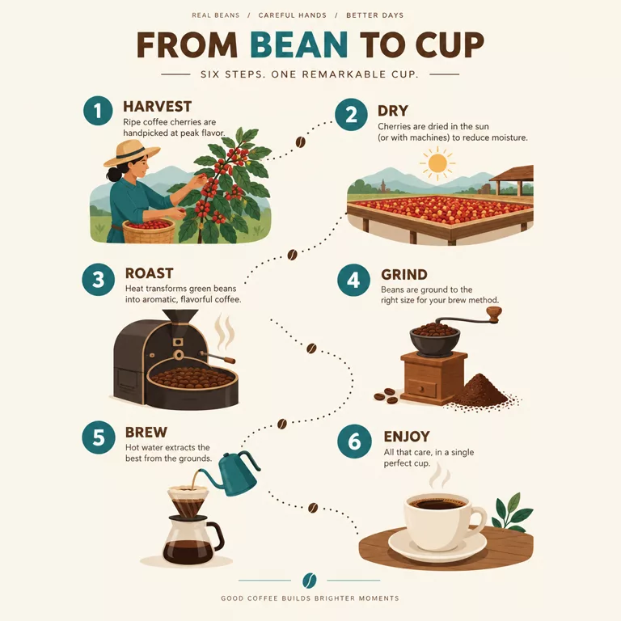

  <a href="https://aiimage.com/pt/gpt-image-2-5?utm_source=github&utm_medium=readme&utm_campaign=awesome-ai-image-prompts"></a>

```text
Infográfico vertical limpo intitulado "FROM BEAN TO CUP",
seis etapas numeradas ligadas por um caminho pontilhado: 1 Harvest, 2 Dry,
3 Roast, 4 Grind, 5 Brew, 6 Enjoy,
cada etapa com uma ilustração vetorial chapada e uma legenda de uma linha,
paleta quente de marrom-café e creme com um toque de azul-petróleo,
bastante espaço em branco, tipografia sem serifa moderna,
estilo editorial de revista
```

<details><summary>English</summary>

```text
Clean vertical infographic titled "FROM BEAN TO CUP",
six numbered steps connected by a dotted path: 1 Harvest, 2 Dry, 3 Roast,
4 Grind, 5 Brew, 6 Enjoy,
each step with a flat vector illustration and a one-line caption,
warm coffee-brown and cream palette with a teal accent, generous white space,
modern sans-serif typography, editorial magazine style
```

</details>

<a id="volcano-cross-section"></a>

### 26. Diagrama em corte de um vulcão

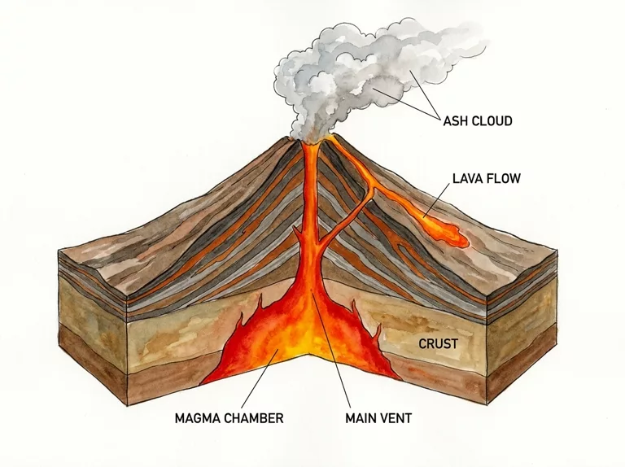

  <a href="https://aiimage.com/pt/nano-banana-pro?utm_source=github&utm_medium=readme&utm_campaign=awesome-ai-image-prompts"></a>

```text
Diagrama educativo em corte de um estratovulcão em erupção para um livro
didático,
vista seccionada mostrando a câmara magmática, a chaminé principal,
uma chaminé lateral, camadas de cinzas e lava e uma nuvem de cinzas acima,
rótulos claros em inglês com linhas de chamada finas: "Magma Chamber",
"Main Vent", "Lava Flow", "Ash Cloud", "Crust",
estilo de ilustração detalhada pintada à mão,
vermelhos e laranjas quentes sobre tons terrosos frios, fundo branco
```

<details><summary>English</summary>

```text
Educational cross-section diagram of an erupting stratovolcano for a school
textbook,
cutaway showing the magma chamber, main vent, side vent,
layers of ash and lava, and an ash cloud above,
clear English labels with thin leader lines: "Magma Chamber", "Main Vent",
"Lava Flow", "Ash Cloud", "Crust", detailed hand-painted illustration style,
warm reds and oranges against cool earth tones, white background
```

</details>

<a id="water-cycle-kids"></a>

### 27. Ciclo da água para crianças

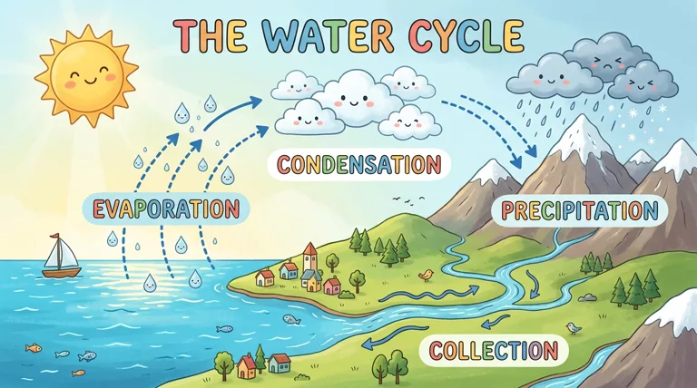

  <a href="https://aiimage.com/pt/nano-banana-2?utm_source=github&utm_medium=readme&utm_campaign=awesome-ai-image-prompts"></a>

```text
Pôster educativo infantil alegre explicando o ciclo da água,
uma paisagem com mar, montanhas e uma vila,
setas curvas mostrando a evaporação do mar, a condensação em nuvens,
a chuva caindo nas montanhas e os rios voltando ao mar,
um sol sorridente e personagens fofos de nuvem,
grandes rótulos arredondados "Evaporation", "Condensation", "Precipitation",
"Collection", cores vivas e amigáveis, estilo de desenho animado 2D suave
```

<details><summary>English</summary>

```text
Cheerful children's educational poster explaining the water cycle,
a landscape with sea, mountains and a village,
curved arrows showing evaporation from the sea, condensation into clouds,
rain falling on the mountains and rivers flowing back,
a smiling sun and cute cloud characters, large rounded labels "Evaporation",
"Condensation", "Precipitation", "Collection", bright friendly colors,
soft 2D cartoon style
```

</details>

<div align="right"><a href="#top">⬆ Voltar ao topo</a></div>

<a id="character"></a>

## Fichas de personagem e assets de jogo

<a id="ranger-turnaround-sheet"></a>

### 28. Folha de giro de personagem

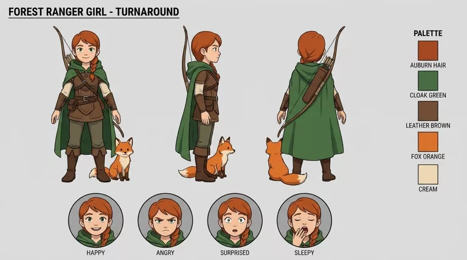

  <a href="https://aiimage.com/pt/nano-banana-pro?utm_source=github&utm_medium=readme&utm_campaign=awesome-ai-image-prompts"></a>

```text
Folha profissional de giro de design de personagem de uma jovem guardiã da
floresta original,
corpo inteiro em vista frontal, lateral e de costas lado a lado,
trança curta castanho-avermelhada, capa verde com capuz, armadura de couro,
um arco longo e uma pequena raposa como companheira,
uma fileira de quatro closes de expressões embaixo (feliz, brava, surpresa,
sonolenta), amostras de paleta de cores à direita,
line art limpo com sombreamento cel chapado, fundo cinza-claro
```

<details><summary>English</summary>

```text
Professional character design turnaround sheet of an original young forest
ranger girl,
full body shown in front view, side view and back view standing side by side,
short auburn braid, green hooded cloak, leather armor,
a longbow and a small fox companion,
a row of four facial expression close-ups at the bottom (happy, angry,
surprised, sleepy), color palette swatches on the right,
clean line art with flat cel shading, light gray background
```

</details>

<a id="pixel-rpg-items"></a>

### 29. Conjunto de itens RPG em pixel art

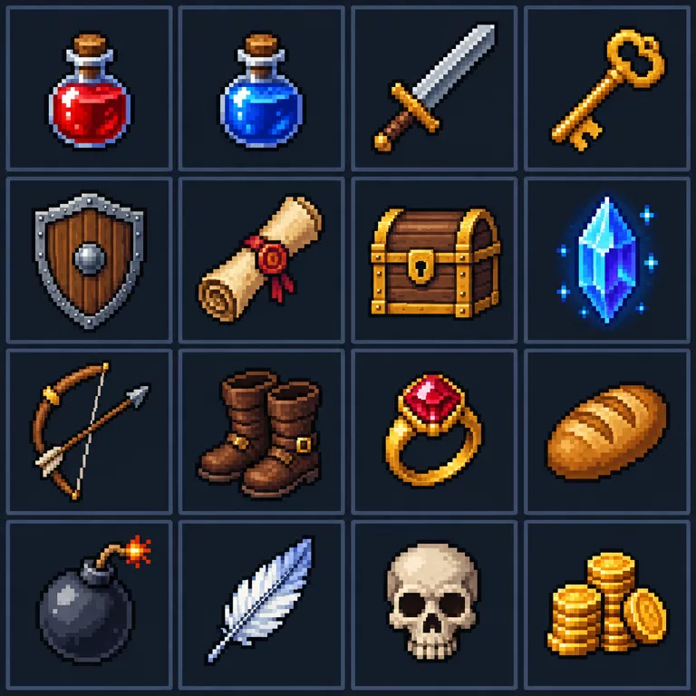

  <a href="https://aiimage.com/pt/gpt-image-2-5?utm_source=github&utm_medium=readme&utm_campaign=awesome-ai-image-prompts"></a>

```text
Folha de sprites em pixel art de 16 bits com itens de RPG de fantasia
organizados numa grade 4×4 sobre fundo ardósia escuro: poção de vida vermelha,
poção de mana azul, espada de ferro, chave dourada, escudo de madeira,
pergaminho mágico, baú do tesouro, cristal brilhante, arco e flecha,
botas de couro, anel de rubi, pão, bomba, pena, caveira, moedas de ouro,
cada item centralizado na sua célula com borda fina, pixels nítidos,
paleta retrô limitada, asset de jogo
```

<details><summary>English</summary>

```text
16-bit pixel art sprite sheet of fantasy RPG items arranged in a neat 4x4 grid
on a dark slate background: red health potion,
blue mana potion, iron sword, golden key, wooden shield, magic scroll,
treasure chest, glowing crystal, bow and arrow, leather boots, ruby ring,
bread loaf, bomb, feather, skull, gold coins,
each item centered in its own cell with a thin border, crisp pixels,
limited retro palette, game asset
```

</details>

<a id="mobile-game-level-map"></a>

### 30. Mapa de fases de jogo mobile

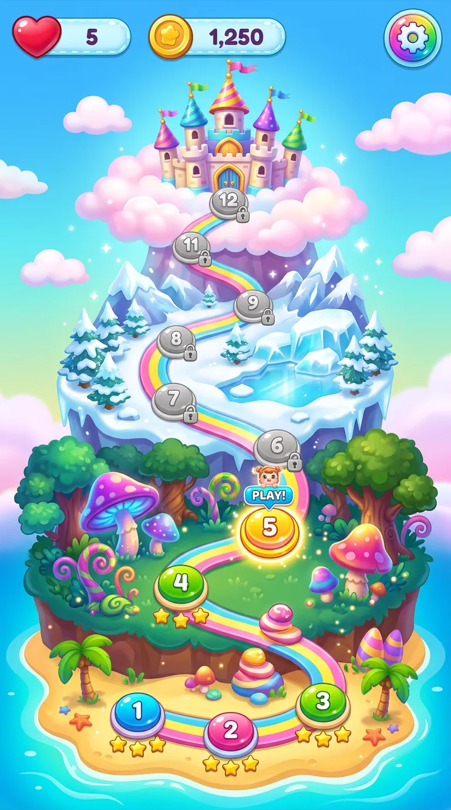

  <a href="https://aiimage.com/pt/nano-banana-2?utm_source=github&utm_medium=readme&utm_campaign=awesome-ai-image-prompts"></a>

```text
Tela vertical de mapa de seleção de fases de um jogo de quebra-cabeça mobile,
um caminho sinuoso cor de bala subindo por uma ilha fantasiosa com praia,
floresta de cogumelos, pico nevado e castelo nas nuvens,
botões redondos numerados de 1 a 12 ao longo do caminho com estrelas douradas
sob as fases concluídas,
um marcador brilhante na fase atual, barra superior com corações,
moedas e botão de configurações, estilo gráfico brilhante de jogo casual,
cores vivas e saturadas
```

<details><summary>English</summary>

```text
Vertical mobile puzzle game level-select map screen,
a winding candy-colored path climbing through a whimsical island with a beach,
a mushroom forest, a snowy peak and a castle in the clouds,
numbered round level buttons 1 to 12 along the path with gold stars under the
completed ones,
a glowing current level marker, top bar UI with hearts,
coins and a settings button, glossy casual game art style,
bright saturated colors
```

</details>

<div align="right"><a href="#top">⬆ Voltar ao topo</a></div>

<a id="social"></a>

## Redes sociais e miniaturas

<a id="youtube-thumbnail-30days"></a>

### 31. Miniatura viral do YouTube

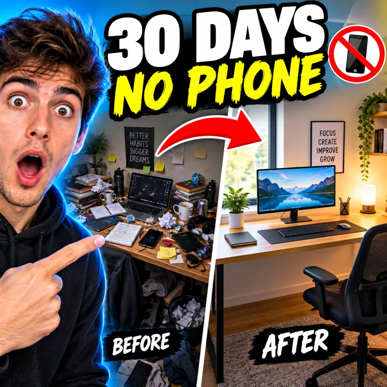

  <a href="https://aiimage.com/pt/gpt-image-2-5?utm_source=github&utm_medium=readme&utm_campaign=awesome-ai-image-prompts"></a>

```text
Miniatura de YouTube cheia de energia,
à esquerda um jovem com expressão de choque exagerada apontando para a
direita,
à direita um antes/depois dividido de uma mesa bagunçada que vira um setup
minimalista perfeitamente organizado,
uma grande seta vermelha curva entre os dois,
enorme texto branco em negrito com contorno preto "30 DAYS" e texto amarelo
menor "NO PHONE",
cores vivas e saturadas, forte luz de contorno na pessoa,
visual de recorte limpo, composição chamativa
```

<details><summary>English</summary>

```text
High-energy YouTube thumbnail,
on the left a young man with an exaggerated shocked expression pointing to the
right,
on the right a split before/after of a messy desk turning into a perfectly
organized minimalist setup,
a big red curved arrow between them,
huge bold white text with black outline "30 DAYS" and smaller yellow text "NO
PHONE",
bright saturated colors, strong rim light on the person, clean cut-out look,
eye-catching composition
```

</details>

<a id="instagram-carousel-cover"></a>

### 32. Capa de carrossel do Instagram

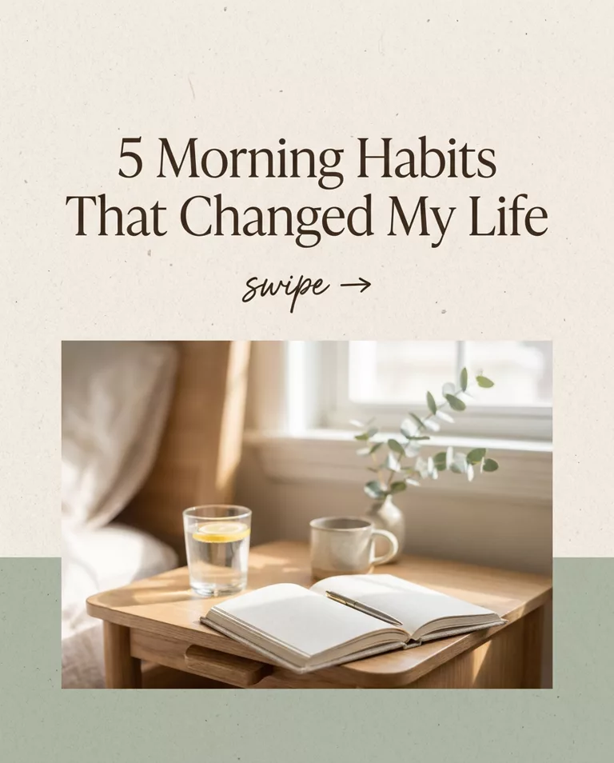

  <a href="https://aiimage.com/pt/nano-banana-pro?utm_source=github&utm_medium=readme&utm_campaign=awesome-ai-image-prompts"></a>

```text
Slide de capa de carrossel do Instagram em estilo estético suave,
grande título elegante com serifa "5 Morning Habits That Changed My Life",
pequeno subtítulo em estilo manuscrito "swipe →",
na metade inferior uma foto de uma mesa de cabeceira iluminada pelo sol com um
copo d'água,
um diário e um raminho de eucalipto, paleta quente de bege e verde-sálvia,
textura sutil de grão de papel, layout equilibrado com hierarquia clara
```

<details><summary>English</summary>

```text
Instagram carousel cover slide in a soft aesthetic style,
large elegant serif headline "5 Morning Habits That Changed My Life",
a small handwritten-style subtitle "swipe →",
a photo of a sunlit bedside table with a glass of water,
a journal and a sprig of eucalyptus in the lower half,
warm beige and sage green palette, subtle paper grain texture,
balanced layout with clear hierarchy
```

</details>

<a id="shiba-sticker-pack"></a>

### 33. Pacote de figurinhas de shiba inu


  <a href="https://aiimage.com/pt/nano-banana-2?utm_source=github&utm_medium=readme&utm_campaign=awesome-ai-image-prompts"></a>

```text
Folha com 9 figurinhas de chat do mesmo shiba inu gordinho de desenho animado
numa grade 3×3,
cada uma com uma emoção diferente e uma legenda curta em negrito: acenando
"Hi!",
olhos de coração "Love it", chorando "Nooo", dormindo "Zzz", joinha "OK!",
bravo "Hmph", rindo "LOL", comendo macarrão "Yum",
escondido debaixo do cobertor "Bye",
contorno branco grosso de recorte em cada figurinha,
design de personagem consistente, cores pastel suaves, estilo kawaii
```

<details><summary>English</summary>

```text
Sticker sheet of 9 chat stickers featuring the same chubby cartoon shiba inu
in a 3x3 grid,
each with a different emotion and a short bold caption: waving "Hi!",
heart eyes "Love it", crying "Nooo", sleeping "Zzz", thumbs up "OK!",
angry "Hmph", laughing "LOL", eating noodles "Yum",
hiding under a blanket "Bye", thick white die-cut outline around each sticker,
consistent character design, soft pastel colors, kawaii style
```

</details>

<div align="right"><a href="#top">⬆ Voltar ao topo</a></div>

<a id="retro"></a>

## Estética retrô e lo-fi

<a id="y2k-digicam-night-market"></a>

### 34. Feira noturna com câmera digital Y2K

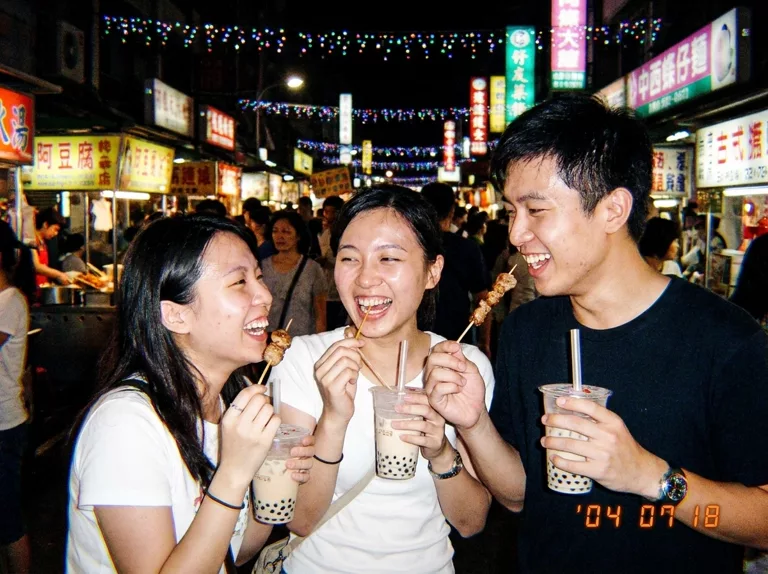

  <a href="https://aiimage.com/pt/nano-banana-pro?utm_source=github&utm_medium=readme&utm_campaign=awesome-ai-image-prompts"></a>

```text
Foto espontânea tirada com uma câmera digital compacta do início dos anos 2000
numa feira noturna asiática lotada,
três amigos rindo e dividindo espetinhos e bubble tea,
flash direto e duro da câmera, rostos levemente estourados,
fundo escuro com luzes coloridas das barracas,
aspecto de sensor CCD de baixa resolução, leve ruído e aberração cromática,
data digital laranja "'04 07 18" no canto inferior direito,
nostálgica e espontânea
```

<details><summary>English</summary>

```text
Candid photo taken with an early 2000s compact digital camera at a crowded
Asian night market,
three friends laughing and sharing skewers and bubble tea,
harsh direct on-camera flash, slightly overexposed faces,
dark background with colorful stall lights, low resolution CCD sensor look,
slight noise and chromatic aberration,
orange digital date stamp "'04 07 18" in the bottom right corner,
nostalgic and spontaneous
```

</details>

<a id="vhs-mall-1989"></a>

### 35. Shopping em VHS de 1989

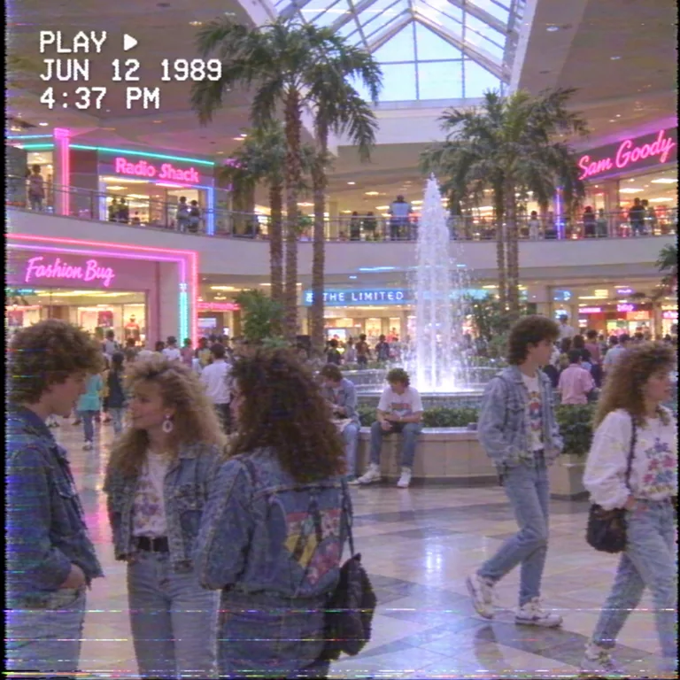

  <a href="https://aiimage.com/pt/gpt-image-2-5?utm_source=github&utm_medium=readme&utm_campaign=awesome-ai-image-prompts"></a>

```text
Quadro congelado de uma fita de vídeo caseira de 1989 gravada num shopping,
vitrines de neon em tons pastel, uma fonte com palmeiras,
adolescentes com cabelos volumosos e jaquetas jeans, átrio com claraboia,
artefatos de VHS: linhas de tracking horizontais, vazamento de cor,
detalhes suaves e borrados, cores desbotadas, entrelaçamento,
carimbo de hora branco da filmadora "PLAY ▶  JUN 12 1989  4:37 PM" no canto,
visual autêntico de vídeo analógico 4:3
```

<details><summary>English</summary>

```text
Still frame from a 1989 home video tape recorded in a shopping mall,
pastel neon storefronts, a fountain with palm trees,
teenagers with big hair and denim jackets, skylight atrium,
VHS artifacts: horizontal tracking lines, color bleeding, soft blurry detail,
washed-out colors, interlacing,
white camcorder timestamp "PLAY ▶  JUN 12 1989  4:37 PM" in the corner,
authentic 4:3 analog video look
```

</details>

<a id="polaroid-desert-roadtrip"></a>

### 36. Road trip no deserto em Polaroid

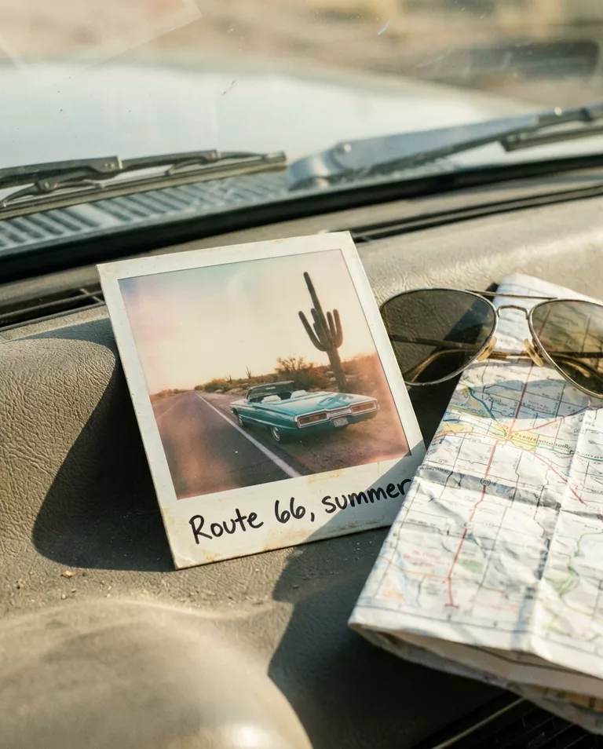

  <a href="https://aiimage.com/pt/nano-banana-2?utm_source=github&utm_medium=readme&utm_campaign=awesome-ai-image-prompts"></a>

```text
Uma foto Polaroid instantânea vintage sobre o painel de um carro,
a foto mostra um conversível turquesa dos anos 1970 estacionado numa rodovia
vazia no deserto ao lado de um alto cacto saguaro ao pôr do sol,
cores quentes desbotadas, vinheta suave, leve vazamento de luz,
borda branca grossa de Polaroid com texto escrito à mão com marcador "Route
66,
summer", óculos de sol e um mapa de papel ao lado,
fotografia analógica nostálgica
```

<details><summary>English</summary>

```text
A vintage instant Polaroid photo lying on a car dashboard,
the photo shows a turquoise 1970s convertible parked on an empty desert
highway beside a tall saguaro cactus at sunset,
faded warm colors, soft vignette, slight light leak,
thick white Polaroid border with handwritten marker text "Route 66, summer",
sunglasses and a paper map next to it, nostalgic film photography
```

</details>

<div align="right"><a href="#top">⬆ Voltar ao topo</a></div>

<a id="editing"></a>

## Edição de imagem (antes → depois)

<a id="edit-fox-autumn"></a>

### 37. Mudar a estação

<table><tr><td width="48%" align="center"><br><sub>Antes</sub></td><td align="center">➜</td><td width="48%" align="center">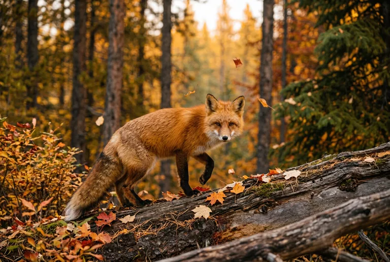<br><sub>Depois</sub></td></tr></table>

  <a href="https://aiimage.com/pt/image-to-image?utm_source=github&utm_medium=readme&utm_campaign=awesome-ai-image-prompts"></a>

```text
Mude a estação desta foto do inverno para um outono dourado: substitua a neve
por folhas de bordo caídas laranjas e vermelhas,
dê às árvores uma folhagem outonal quente e transforme a luz num brilho suave
de fim de tarde. Mantenha exatamente iguais a raposa,
sua pose, o tronco e o ângulo da câmera.
```

<details><summary>English</summary>

```text
Change the season of this photo from winter to golden autumn: replace the snow
with fallen orange and red maple leaves,
give the trees warm autumn foliage,
and make the light a soft late-afternoon glow. Keep the fox, its pose,
the log and the camera angle exactly the same.
```

</details>

<a id="edit-fisherman-charcoal"></a>

### 38. De foto a desenho a carvão

<table><tr><td width="48%" align="center"><br><sub>Antes</sub></td><td align="center">➜</td><td width="48%" align="center">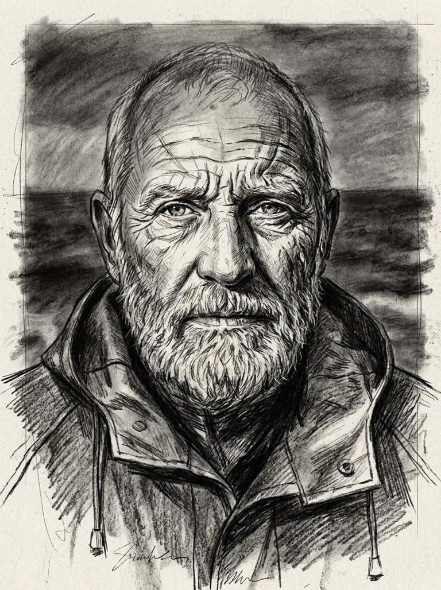<br><sub>Depois</sub></td></tr></table>

  <a href="https://aiimage.com/pt/image-to-image?utm_source=github&utm_medium=readme&utm_campaign=awesome-ai-image-prompts"></a>

```text
Transforme esta foto num desenho realista a carvão sobre papel off-white
texturizado: hachuras expressivas para as rugas e a barba,
pretos profundos esfumados no fundo,
algumas linhas de construção soltas nas bordas e uma pequena assinatura do
artista no canto. Mantenha o rosto,
a expressão e a composição iguais.
```

<details><summary>English</summary>

```text
Turn this photo into a realistic charcoal drawing on textured off-white paper:
expressive hatching strokes for the wrinkles and beard,
deep smudged blacks in the background,
a few loose construction lines at the edges,
and a small artist signature in the corner. Keep the face,
expression and composition the same.
```

</details>

<a id="edit-matcha-ecommerce"></a>

### 39. De foto lifestyle a imagem de e-commerce

<table><tr><td width="48%" align="center"><br><sub>Antes</sub></td><td align="center">➜</td><td width="48%" align="center">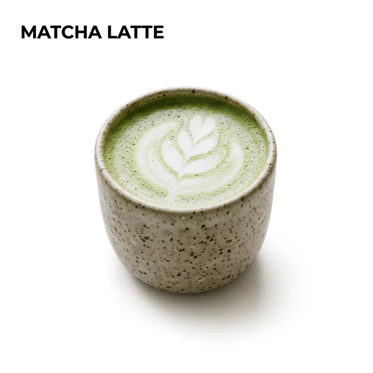<br><sub>Depois</sub></td></tr></table>

  <a href="https://aiimage.com/pt/image-to-image?utm_source=github&utm_medium=readme&utm_campaign=awesome-ai-image-prompts"></a>

```text
Transforme este flat lay numa imagem de produto limpa para e-commerce: isole
apenas a xícara de cerâmica com o matcha latte,
mostre-a num leve ângulo de três quartos sobre fundo branco puro com uma
sombra natural suave,
mantenha a latte art em forma de folha e a textura do esmalte da xícara,
e adicione um pequeno rótulo em negrito "MATCHA LATTE" no canto superior
esquerdo.
```

<details><summary>English</summary>

```text
Turn this flat lay into a clean e-commerce product image: isolate only the
ceramic cup of matcha latte,
show it at a slight three-quarter angle on a pure white background with a soft
natural shadow,
keep the leaf latte art and the cup's glaze texture,
and add a small bold label "MATCHA LATTE" in the top left corner.
```

</details>

<div align="right"><a href="#top">⬆ Voltar ao topo</a></div>

<a id="tools"></a>

## Ferramentas de imagem grátis

Dê o toque final nas imagens geradas com as ferramentas online gratuitas do AIImage.com:

<table>
<tr><td align="center" width="33%"><a href="https://aiimage.com/pt/background-remover?utm_source=github&utm_medium=readme&utm_campaign=awesome-ai-image-prompts"><b>Remover fundo</b></a></td><td align="center" width="33%"><a href="https://aiimage.com/pt/remove-object?utm_source=github&utm_medium=readme&utm_campaign=awesome-ai-image-prompts"><b>Remover objeto</b></a></td><td align="center" width="33%"><a href="https://aiimage.com/pt/change-background-color?utm_source=github&utm_medium=readme&utm_campaign=awesome-ai-image-prompts"><b>Mudar cor de fundo</b></a></td></tr>
<tr><td align="center" width="33%"><a href="https://aiimage.com/pt/image-to-image?utm_source=github&utm_medium=readme&utm_campaign=awesome-ai-image-prompts"><b>Imagem para imagem</b></a></td><td align="center" width="33%"><a href="https://aiimage.com/pt/gif-maker?utm_source=github&utm_medium=readme&utm_campaign=awesome-ai-image-prompts"><b>Criador de GIF</b></a></td><td align="center" width="33%"><a href="https://aiimage.com/pt/compress-image?utm_source=github&utm_medium=readme&utm_campaign=awesome-ai-image-prompts"><b>Comprimir imagem</b></a></td></tr>
</table>

[Ferramentas de imagem grátis →](https://aiimage.com/pt/tools?utm_source=github&utm_medium=readme&utm_campaign=awesome-ai-image-prompts)

<a id="api"></a>

## Gerar via API

Todas as prévias foram geradas com o [RouterBase](https://routerbase.com), uma API compatível com OpenAI para Nano Banana, GPT Image, Gemini, Seedream e outros:

```bash
curl https://routerbase.com/v1/images/generations \
  -H "Authorization: Bearer $ROUTERBASE_API_KEY" \
  -H "Content-Type: application/json" \
  -d '{"model": "google/gemini-nano-banana-2.1-t2i", "prompt": "…", "aspect_ratio": "16:9"}'
```

<a id="tips"></a>

## Dicas para escrever prompts

1. **Assunto primeiro**: diga claramente o que a imagem mostra e depois acrescente detalhes.
2. **Nomeie a técnica**: foto, aquarela, render 3D, ukiyo-e, pôster…
3. **Descreva a luz**: hora dourada, iluminação Rembrandt, neon, céu nublado.
4. **Use termos de câmera** em fotos: lente (35 mm, 85 mm), abertura (f/1.4), ângulo.
5. **Coloque o texto entre aspas**: os modelos desenham `"JAZZ NIGHTS"` com muito mais precisão.

<a id="contributing"></a>

## Contribuindo

PRs são bem-vindos! Adicione uma entrada em `prompts.json` (nos 8 idiomas ou só nos que você domina) e rode `python3 scripts/generate.py` e `python3 scripts/build_readme.py`.

## Licença

Prompts e imagens são publicados sob [CC0 1.0](LICENSE): use para qualquer finalidade, sem necessidade de atribuição.

---

<div align="center">

Se esta coleção te ajudou, deixe uma ⭐ estrela!

<a href="https://aiimage.com/pt?utm_source=github&utm_medium=readme&utm_campaign=awesome-ai-image-prompts">AIImage.com</a> · <a href="https://routerbase.com">RouterBase</a> · <a href="#top">⬆ Voltar ao topo</a>

</div>
